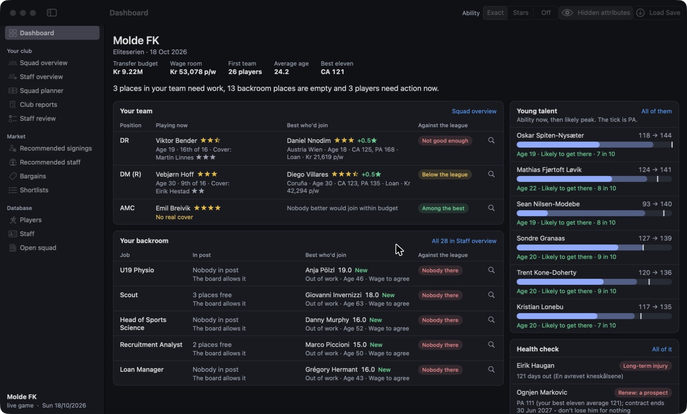
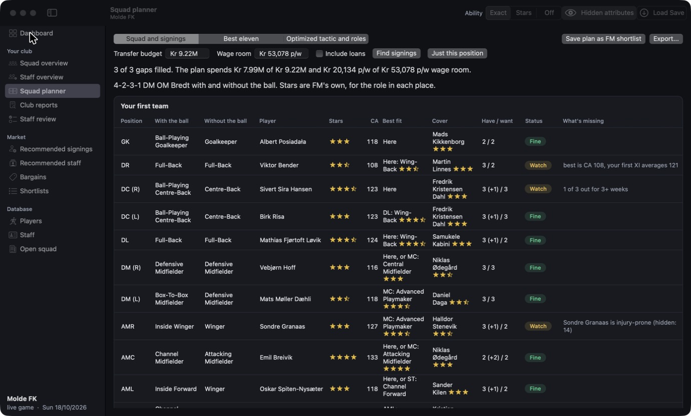
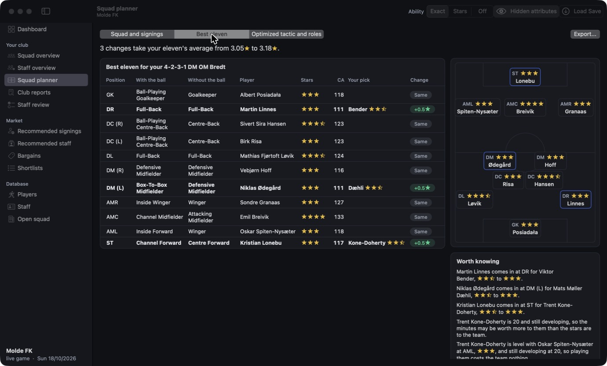
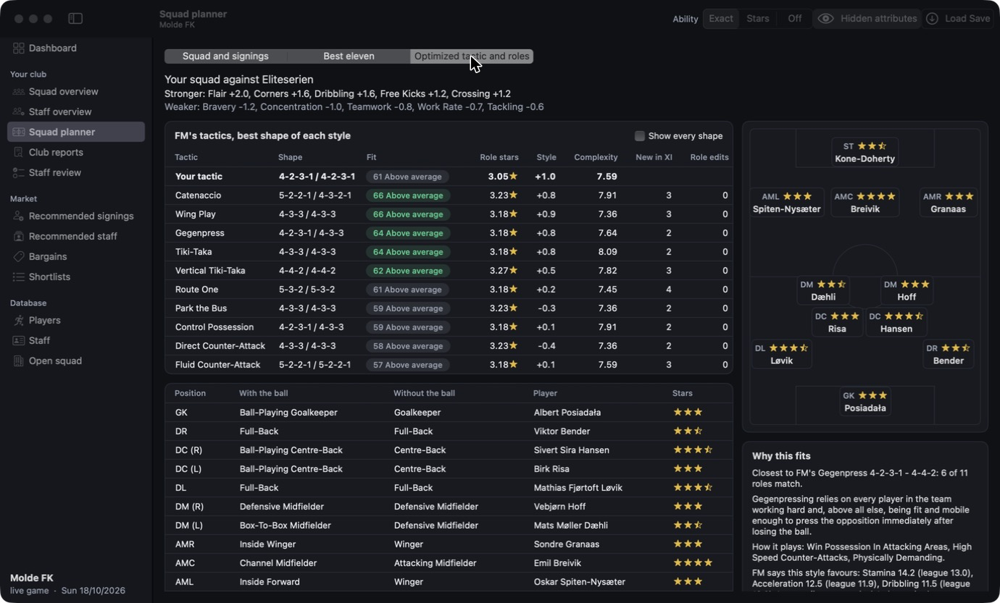
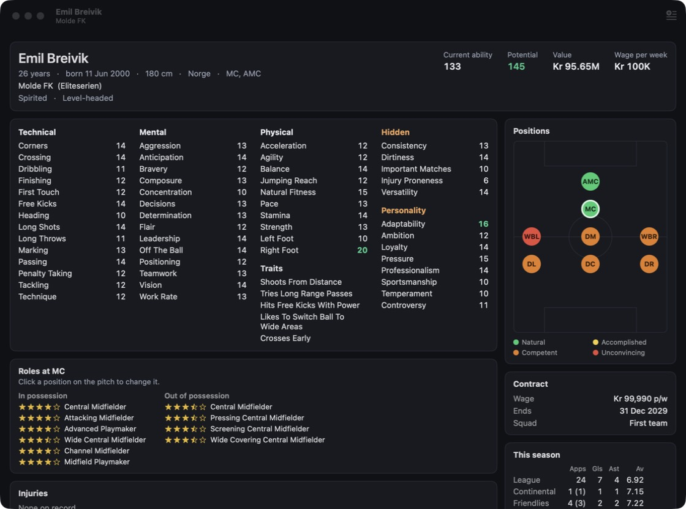
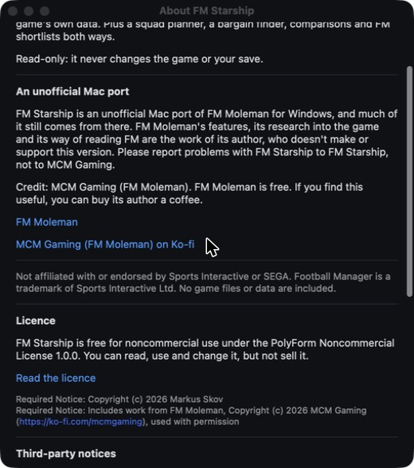

# FM Starship

[](https://github.com/FMStarship/FMStarship/actions/workflows/ci.yml)
[](https://github.com/FMStarship/FMStarship/releases/latest)
[](LICENSE.md)

A native Mac scouting and club-management companion for Football Manager 27. It reads your running save and shows everything
the game knows about every player and member of staff, using the game's own rules for things like who would join you. On top of
that it has a club dashboard, squad and staff overviews, a squad planner built on your own tactic, a best eleven, and tactic advice
fitted to your squad. As a preview, it can also run [inside FM](#inside-fm-preview), as an FM STARSHIP tab made of the game's own
interface elements and player tables.



## Origins and credit

FM Starship is an unofficial Mac port of [FM Moleman](https://sortitoutsi.net/content/78068/fm-moleman-27), the free Windows tool.
FM Moleman's author doesn't make or support this version, so please [report Mac problems here](https://github.com/FMStarship/FMStarship/issues),
not to them.

Credit: **[MCM Gaming (FM Moleman)](https://ko-fi.com/mcmgaming)**. Much of FM Starship still comes from FM Moleman: the features,
the way the reader finds things in FM's memory, and the search, recommendation and file code, which were translated to Swift from
the Windows app. The Mac-only parts are listed further down. If FM Starship is useful to you, you can support MCM Gaming on Ko-fi.

FM Starship's own work is the in-game plugin (whose lists use the same search and recommendation code), the agent loaded into FM,
the ARM64 interpreter and its sandbox, tactic reading, the best eleven and optimized tactic, development curves and odds, the club
dashboard, the squad and staff overviews, and the app's design. The idea of running FM's own rules in an emulator, and which rules
to run, come from FM Moleman, whose emulator runs x86-64.

## What you need

- A Mac with Apple Silicon, on macOS 14 or later
- The Steam version of Football Manager 27. Other stores aren't supported.
- FM27 build 27.0.1 (the full release) for everything to work. When SI patches the game, features that run FM's own code switch
  off until FM Starship catches up. They switch off rather than show wrong numbers, and Help > Compatibility shows what's working on
  your build.

## Using it

1. Download the disk image from [Releases](https://github.com/FMStarship/FMStarship/releases/latest), open it and drag FM Starship to
   Applications. To build it yourself, run `Scripts/build-app.sh`, then open `build/FM Starship.app`.
2. **Start Football Manager from FM Starship**, not from Steam. Press Start Football Manager. Steam stays connected.
3. Load your save in the game, then press **Load Save** in FM Starship.

The app opens on your club's dashboard: what needs a decision, who's coming through, and what the health check wants done. Press
Load Save again whenever you want fresh numbers.

CA, PA and hidden attributes stay off until you press **Hidden attributes** in the toolbar, because FM keeps them from you as well.
With that on, Ability chooses whether CA and PA show as numbers, as stars or not at all.

If FM is already running when you open FM Starship, the app asks you to save and quit it first. It never closes the
game for you.

## Inside FM (preview)

FM Starship can also run inside FM27, as an **FM STARSHIP** tab at the end of FM's own tabs in the top bar. Its screens are made of
FM's own interface elements and text styles, and its lists are FM's own player and staff tables. Names open FM's profiles, every
column sorts, FM's Back button returns to the list, and FM's right-click menu works on the rows.

The tab has these screens:

- **Dashboard:** young talent and the health check
- **Recommended signings** and **Bargains**, each with an Edit Search laid out like FM's own
- **Squad planner:** your first team, place by place, and the signings for the plan
- **Shortlists:** the player shortlists you've saved from the app
- **Players** and **Staff:** the app's own searches, with its filters

Like FM's own tabs, FM STARSHIP has an arrow beside its name that opens a menu of these screens, from any of FM's screens.
**Ability** and **Hidden attributes** are at the right of each screen's title row, and set the same settings as the app's toolbar.
Control-Option-S opens the app's own windows over FM, for everything else, including Settings. When FM is in a window rather than
full screen, its menu bar has an FM Starship menu too.

### Installing it

The app carries the plugin, so you don't need Xcode.

1. In FM Starship, choose **FM Starship > Add FM Starship to FM**. It puts the plugin and a small launcher app in
   `~/Library/Application Support/FMStarship/Plugin`, then shows a Steam launch option like this one, with a Copy button:

   ```
   "/Users/you/Library/Application Support/FMStarship/Plugin/FM Starship Launcher.app" %command%
   ```

2. In Steam, open Football Manager 27 > Properties > General > Launch Options, and paste it in. Steam doesn't let other apps
   set it, so this is the one step you do yourself, once.
3. Start FM from Steam and load your career. The FM STARSHIP tab appears after FM's own tabs.

Steam then starts the launcher in FM's place, and the launcher starts FM with the plugin. Starting FM from the app's Start Football
Manager button doesn't load the plugin. The app can still read a game started from Steam this way, without a restart.

Adding it is safe while FM is running: a game that's open keeps what it has, and the next start of FM from Steam gets the new copy.
When the app updates, it updates its copy of the plugin the next time it opens, and the launch option stays the same. To remove it,
choose **FM Starship > Remove FM Starship from FM**, then clear the launch option in Steam. Remove leaves the launcher in place, so
until you do, Steam still starts FM, without FM Starship.

**To build the plugin yourself**, run `Scripts/install-plugin.sh` in a copy of the source. You need Xcode and Homebrew's `zstd`, as
[CONTRIBUTING.md](CONTRIBUTING.md#getting-set-up) explains. It puts your own build in the same folder and prints the same launch
option. The app leaves a build of your own alone when it starts, and asks before Add FM Starship to FM replaces it.
`Scripts/install-plugin.sh --plugin-only` (with `--developer` if you want the developer tools) replaces only the plugin and leaves
the launcher, for quick rounds after a full install. `Scripts/install-plugin.sh --uninstall` removes the plugin and keeps the
launcher, as Remove does, so Steam still starts FM; `--uninstall-all` removes the whole folder, once the launch option is cleared.

### What to know

- **It's a preview.** It has only been tried on FM27 27.0.1.2503222 (12 November's update), 27.0.1.2494769 (the full release)
  and the Launch Preview build before it, with FM in full screen. It finds FM's interface by the names of FM's classes, methods and
  elements, which an FM patch can change, so it only starts on the builds of FM it has been checked on. **After an FM patch**, FM
  starts as normal without the tab, and the app tells you once. The tab comes back with the FM Starship update that lists the new
  build. Clear the launch option to play without it altogether.
- **It runs inside FM**, so if the plugin crashes, FM closes with it. Save your career before you try something new. If FM closes
  twice in a row before the tab has settled in, FM starts without it until the next FM Starship update, and the app tells you why.
  Add FM Starship to FM lets it try again sooner.
- **It never writes your save, and it doesn't patch FM's code.** It adds its screens to FM's interface through the IL2CPP API that
  FM's game code exports. But FM's own right-click menu on our rows acts in the game, as it does in FM's lists, so an offer or an
  approach made from it is real.
- **Hidden attributes works as in the app**, and the tab's switch is the same setting as the eye in the app's toolbar. With it off,
  the tables show FM's own scouting columns instead of CA and PA.
- It reads your save when you first open the tab, and again when you next open it after FM has loaded another save or moved on, so
  it never shows people from a save FM no longer has. It says it's reading until it's done.
- Players and Staff put the first 500 people a search finds in FM's table, and say how many were found.
- Shortlists only reads the files. Make and change shortlists in the app. Staff shortlists aren't there yet.
- The lists need FM's own player and staff tables, which the plugin takes from an FM screen that has one, such as your Squad or
  Club > Staff. Until you've opened one, they're plain lists, without sorting or right-click, and say so. After that, they're
  remembered until FM's next patch.
- The plugin never goes online, and it doesn't update itself. The app updates it, from its own copy.
- It writes what it does to `~/Library/Logs/FM Starship/plugin.log`. Please attach that file to a bug report about the plugin.

## Updates

FM Starship asks before it starts looking for updates, then checks GitHub about once a day, and you can check yourself with
FM Starship > Check for Updates. That's the only thing it goes online for, and nothing about your save is sent. It doesn't
check while Football Manager is running, because installing an update restarts FM Starship. You can turn this off in Settings.
Updates are signed, so a fake one gets refused. Builds you make yourself don't update.

## Screenshots

These come from a real save played in Norwegian, so formation names read the way FM shows them in that language.

**Squad planner**



**Best eleven**



**Optimized tactic**



**Player profile**



**About, with the credit and licence**



## How it works

An app can't read FM's memory from outside on a Mac: macOS refuses that for hardened apps, and a process that hands out
its own task port is killed by the kernel. So:

- **A small agent is loaded into FM at launch** (`agent/agent.c`, about 200 lines), through the
  `allow-dyld-environment-variables` entitlement FM27 ships with. No game file is changed, and the agent only
  exists for launches made from FM Starship. FM loads a copy from `~/Library/Application Support/FMStarship`, so
  replacing the app never touches the agent a running game is using.
- **The agent only answers read requests**, over a private Unix socket. The protocol has no write operation. It
  hooks nothing and patches nothing. This is a promise made by the code, not one enforced by the kernel.
- **Stale pointers are safe.** Reads report bad addresses as errors, and the socket cannot raise SIGPIPE in the game.

**The game's rules** ("would he join you", staff interest, season stats) are not reimplemented. FM's own compiled code
is run on a copy of its memory, inside an ARM64 interpreter (`Sources/CA64`), because ARM64 is what FM runs on a Mac.
All writes go to a private overlay that is thrown away after each call, so this code can never change your game or save.

**The plugin** (`Sources/StarshipPlugin`) is a library that FM's Steam launch option loads into the game:

- **Steam starts the launcher** (`plugin/launcher.c`) in FM's place. The launcher starts FM with the plugin in
  `DYLD_INSERT_LIBRARIES`, through the same entitlement the agent uses, and waits for FM to quit, so Steam still sees the game
  running. The plugin clears that variable as it loads, so nothing FM starts inherits it, and it does nothing in any process but
  FM's (`Sources/StarshipPluginStart`).
- **The launcher stops a crash loop.** Once FM Starship's tab has been in FM's bar for 10 seconds, the plugin leaves a mark
  beside itself to say its start went well. If FM crashes before that, whether at the main menu or while your career loads,
  however long you took, and does so at two starts with the same copy of the plugin with no good start between them, the
  launcher starts FM without it from then on. A crash after the tab has settled in doesn't count, nor does quitting FM
  yourself, nor a crash more than half an hour after starting with the tab still not in. It says why in the plugin's log and
  in `status.json` beside the plugin, for the app to show. A new copy of the plugin, from the app's update or Add FM
  Starship to FM, goes back in.
- **It reads the save from inside FM**, with the same reader, in about 2 seconds instead of about 100 through the agent. The
  rules run in the same sandbox. It carries the agent too, so the app and `fmprobe` can read a game started this way.
- **It builds its screens through the IL2CPP API** that FM's `GameAssembly` exports (`IL2CPP.swift`), on Unity's main thread.
  It makes FM's own interface elements and tables, gives them their style classes, rows and columns through FM's own methods, and
  gets clicks back through delegates of its own. FM's code isn't patched, and no game file is changed. FM keeps how our tables
  are sorted with its own interface settings, as it does for its own tables.
- **It never writes the save.** Anything that acts in the game is one of FM's own actions, chosen by the player from FM's
  right-click menu on our rows.

## What works

What FM Starship does on FM27 27.0.1 for Mac, and where each answer comes from. [Origins and credit](#origins-and-credit) says
more about where it began.

- **Began in FM Moleman:** reading players, staff and contracts; the rules for would join, roles, season stats, staff limits,
  preferred job and injury days; the Squad planner, though its tactic slots are FM Starship's; Recommended signings, Bargains,
  Recommended staff, Staff review, Compare and Open squad; My club; the filters, columns and search; and shortlists, snapshots,
  export and themes.
- **Began in FM Starship:** formation names, reading your tactic, the club dashboard, the Squad and Staff overviews, Best eleven,
  Optimized tactic, development curves and talent odds, and the in-game plugin.

| Feature | How it's done |
| --- | --- |
| Players, staff, attributes, hidden attributes, CA/PA, personality, traits | Read from memory |
| Contracts, clauses, loans, squads, injuries, values, currencies, budgets | Read from memory |
| Form, job preferences | Read from memory |
| Would join you (transfer and loan), staff interest | FM's own functions |
| Role stars, in and out of possession, at every position | FM's own functions |
| Season stats, board staff limits, preferred job | FM's own functions |
| Exact injury return days | FM's own function |
| Formation names, in the game's language | FM's own function |
| Your tactic: formation, roles with and without the ball, your XI | Read from memory |
| Club dashboard: what needs a decision, who's coming through, what the health check wants done | Built on the answers above |
| Squad and Staff overviews: each place, how it stands against the league, and the best person who'd join | Built on the answers above |
| Best eleven: your tactic's places and roles with the best the club has in each, against your own picks | FM's own role ratings |
| Optimized tactic and roles: FM's 90 preset tactics fitted to your squad | FM's own files and role ratings |
| Development curves and talent odds: each young player's likely peak, and the odds of getting close to PA | Measured from every player in your save |
| Squad planner: one row per slot in your tactic, cover, best position and role | FM's own role ratings |
| Recommended signings, Bargains, Recommended staff, Staff review, Compare, Open squad | Built on the answers above |
| My club: health check, set pieces, loan out, development, training | Built on the answers above |
| Filters, columns, search, units | In the app |
| FM shortlists both ways, snapshots, export, themes | FM's own shortlist files. Snapshots use FM Starship's own format |
| The FM STARSHIP tab inside FM, with FM's own player and staff tables (preview) | FM's IL2CPP API |

Help > Compatibility shows what is working on the build you have.

## After an FM patch

Records are found by class name, so the reader usually keeps working. Its offsets are all in
`Sources/StarshipCore/Reader/MacLayout.swift`. If they move, Load Save's self-check fails and FM Starship warns that
the numbers on screen may be wrong.

The rule functions are found by address, which only holds for one build. `RulesEngine` compares a fingerprint of
`game_plugin` and **refuses to start on any other build**, so those features switch off rather than give wrong
answers. To bring them back, find the new values for the `Mac27` constants in
`Sources/StarshipCore/Emu/RulesEngine.swift`.

**Match the new build to the old one by code, then check each value.** Keep a copy of `game_plugin` from the build
`Mac27` was made for, because Steam replaces it when it patches FM, and run:

```bash
python3 -I tools/match_builds.py OLD_GAME_PLUGIN NEW_GAME_PLUGIN
```

It takes the old values from `Mac27`, only reads the two files, and takes about half a minute. A patch adds and removes
functions, so they can't be paired by their place in the list. They're paired by their code instead, with addresses
blanked out, so a function that only moved still matches. Then each value is checked by what it is:

- **A function** is proven when its code is the same and so are the constants it loads. Callers whose own code didn't
  change must call the new address too, which also finds a function that was recompiled.
- **A global** is what the same instruction uses in every unchanged function that used the old one.
- **A vtable slot** is read from RTTI: the slot must hold the same function, with the same code.
- **The staff slots** are counted from FM's own calls through `staffNumbersGlobal`, which must be the same in both builds.

Each value ends **FOUND**, proven by code that didn't change, **CHECK**, found but its code changed, or **MISSING**.
FOUND values can go straight into `Mac27`. Check each CHECK by hand first:

- Compare the two functions' code, for example with `xcrun llvm-objdump -d --start-address=… --stop-address=…`.
  "The same instructions in another order" means the compiler moved blocks around, so check that each branch still
  leads to the same result, such as every case of a switch.
- Recompiled code can't be compared line by line. Run both versions on the same inputs, or check the feature in FM:
  role stars on a player's profile, or `fmprobe shapenames` for formation names.
- Find a MISSING value the old way, below.

On 27.0.1.2494769, 21 of the 24 values were FOUND. `statusFunction` (a switch's blocks reordered),
`roleListInPossession` and `shapeName` (both recompiled) needed checking by hand. A note that a value calls a function
whose code changed doesn't count against it, because the rules engine runs FM's new code as it is. The tool also checks
the reader's classes, their base-class offsets and the code that builds their vtables. That's a good sign, but only
Load Save's self-check proves the reader.

When a value can't be matched: the binary is stripped, so the method is to **run every function through the sandbox
and keep the ones that reproduce an answer the game has already stored**. Crashes and wild jumps only stop one emulated
call. `tools/scan_a64.py` extracts the function list, and `fmprobe hunt` / `fmprobe huntmore` do the search. This is
how each value was first found:

| Value | How it was found |
| --- | --- |
| `fingerprint` | First 16 hex digits of the SHA-256 of the arm64 slice (`fmprobe fingerprint`) |
| `interestSlot` | `GAME_ACTUAL_PLAYER` vtable; calls with `w3` = 3 or 4 through `ldr x8, [x8, #0xf0]` |
| `interestManagerGlobal` | The `adrp`/`ldr` just before those calls |
| `statusFunction` | The `bl` just before them, followed by `cmp w0, #7` |
| `staffRuleSlot` | Last slot of `PERSON_NON_PLAYER_INTERESTED_FILTER_RULE` |
| `statFunction` | Called most often with `w1` = 84 (Apps) and `w2` = 5 |
| `statsContainerSlot` | The vtable call producing `x0` at those sites |
| `roleInPossession`, `roleOutOfPossession` | `fmprobe hunt ip` / `oop`: the player's stored best role must outrank every other |
| `roleBand` | Right after the in-possession rating; takes (player, rating, team, out) |
| `roleListInPossession`, `roleListOutOfPossession` | `huntmore rolelist3`: most players' top role is in the list for their position |
| `preferredJob` | `huntmore job`: staff with one clear favourite job |
| `injuryInfo`, `bagSet`, `bagClear` | The function that uses key `0x50504d69` with a 4-argument signature |
| `staffNumbersGlobal`, slots | `fmprobe huntlimits`: the per-team tables must add up to the club's real staff |
| `staffModeFlags` | The two bytes the staff-number functions compare against 2 and 3 |
| `shapeName` | Takes eleven sorted place numbers in `x0` and returns a string through `x8`. `fmprobe shapenames` shows when it's right |

The optimizer reads FM's own tactic data from `game_plugin.bundle/Contents/Resources/shared/data/simatch.fmf`, so it follows
patches: the `.tac` presets, `styles.xml` (favoured attributes, preferred roles, features of play) and the role complexity
table. `FMData` reads the container and `.tac` format, and `swift test` checks them against the installed game. Fit is this
app's own blend, not an FM number; the tactics, roles, stars, attributes and complexity are FM's. A preset's role only changes to
one FM uses in that place in that style, and only if FM's presets put it next to the neighbouring roles.

The plugin finds FM's interface by name: classes, methods and fields through IL2CPP's metadata, and elements and style classes
in FM's live interface. A patch that renames them can stop the tab appearing or a screen opening, and `plugin.log` says what it
couldn't find. Built with `Scripts/install-plugin.sh --developer`, the plugin writes FM's live interface out with
Control-Option-D, which is how those names were found. [CONTRIBUTING.md](CONTRIBUTING.md#working-on-the-plugin) covers the other
developer tools.

The plugin also **stays out of any build of FM nobody has checked**: no tab, no menu, nothing hooked, one line in `plugin.log`,
and a `status.json` beside it that the app reads to tell the player. A build is FM's version with `GameAssembly`'s UUID
(`dwarfdump --uuid` on `fm.app/Contents/Frameworks/GameAssembly.dylib`, the arm64 one). A developer build, from
`Scripts/install-plugin.sh --developer`, starts anyway, which is how a new build gets checked. Once every plugin screen has
worked on it, add the build to `CheckedBuilds.list` in `Sources/StarshipCore/Memory/CheckedBuilds.swift`, and players get the
tab back with the next update.

FM Starship's own parts, and how to check them after a patch:

- **Your tactic** is read from `TACTIC_EDIT_SESSION` objects, with offsets in `MacLayout.Tactic`. If they move, the planner
  falls back to its ten position groups, and Help > Compatibility says so. To find them again, search memory for your
  XI's player indexes in order (`fmprobe cluster`), then see which class holds them (`fmprobe census`, `fmprobe fields`).
  `fmprobe tactic` prints what the app read. Stars are the check: FM's tactics screen shows the two phases' average, rounded up.
- **Squad overview and Staff overview** are `OverviewReport`s: each place, how it stands against the league, and the best
  person who'd join. Staff jobs come from FM's own board table, `StaffLimits.Club`. Its entries were matched to jobs by comparing
  them with who holds each job at 600 clubs, which `fmprobe staffmap 7 600` repeats if a patch reorders them.
- **Development** comes from the save, not from a rule of thumb: `DevelopmentCurve` measures how much of their PA players of each
  age have reached, across the world, and projects each young player along their own line. `fmprobe agecurve` prints those lines.
  It also measures the odds of getting close to PA by Determination + Professionalism + Ambition, and by Injury Proneness, from
  everyone aged 25-29. `fmprobe hiddencsv` dumps the numbers behind that. Nothing about this is a formula from the game: the growth
  routine wasn't found. What the code does show, on 27.0.0.2493426: player creation at `game_plugin+0x112c0e4` gives high-PA
  players a floor for those three stats (PA 125+ 8, 150+ 10, 175+ 12) unless a roll skips it, and `+0xd34458` is a one-off jump
  of 10-20% of CA, capped by PA.
- **Formation names** are FM's, and nothing here works them out. `RulesEngine.shapeName` runs FM's own routine, which answers in the
  language the game is set to, so a custom shape gets its name too. `fmprobe shapenames` tries it on FM's built-in formation table.
  When the rules are off, `TacticLibrary` falls back on the presets in the player's own install, whose file names carry the names
  (`4--4-2-3-1 DM AM Wide _ 4-4-2 2DM - gegenpress.tac`), and a shape no preset uses gets a plain count of its lines: `4-1-1-4-0`.
  The routine reads a language file from disk for an Asymmetric name, which the sandbox can't do, so lopsided shapes are counted too.
- **The dashboard** is `ClubDashboard` plus the two overviews, which it starts itself so their answers are ready when you open them.
- **The look** lives in `AppColors` (colours by job, from a `Theme.Palette`, or the system's for the System theme), `DesignSystem.swift`
  (panels, pills, `Flow`, range bars) and `TableSupport.swift` (both grids). DESIGN.md is the reference. Grids never cut text off: `AnalysisGrid`
  wraps sentences, then scrolls sideways, and `PeopleTable` fits columns to a sample of the rows once per list. `PitchPlan` places cards on a
  pitch without any UI, so `swift test` can hold every shape FM ships to having no overlaps.
- **Currency** comes from `selected_currency` in FM's preferences. It counts a 66-entry list of FM's own, held at
  `game_plugin+0x56c0860` on 27.0.0.2493426 as 32-byte entries of (double rate, ...), which is how `Units.fmCurrencies`
  was named.

`tools/run-emutest.sh` proves the interpreter still matches the real CPU, so run it after any change there.
`swift test` covers the shortlist and export file formats and the tactic logic.

## Layout

| Path | What |
| --- | --- |
| `agent/` | The library the app loads into FM, also built into the plugin |
| `plugin/` | The launcher Steam starts in FM's place |
| `Sources/CA64` | ARM64 interpreter, verified instruction-for-instruction against the real CPU |
| `Sources/StarshipCore` | Memory access, RTTI, the reader, the data model, the rules engine |
| `Sources/StarshipSearch` | Columns, filters, units, settings |
| `Sources/StarshipAnalysis` | Recommendations, planner, bargains, club reports |
| `Sources/StarshipFiles` | Shortlists, snapshots, export, themes |
| `Sources/FMStarship` | The app's screens, shared by the app and the plugin |
| `Sources/FMStarshipApp` | The app's entry point, its updater, and Add FM Starship to FM |
| `Sources/StarshipPlugin` | The plugin: the IL2CPP bridge, FM's tables, and the screens inside FM |
| `Sources/StarshipPluginStart` | Starts the plugin, only inside FM |
| `Sources/fmprobe` | Developer probe |
| `Assets` | The app icon and the README's screenshots. `Scripts/make-icon.py` draws the icon, and needs `rsvg-convert` |

Building needs Xcode and Homebrew's `zstd` (`brew install zstd`). It is linked statically, so the finished app has no
Homebrew dependency. `Scripts/release.sh` makes the signed, notarized disk image and the update feed; the top of that script
says what they need.

## Known limits

- FM keeps some B teams (in Spain and the MLS, for example) as clubs of their own. Best eleven counts a club's players there, but
  other screens show them as on loan, the way FM's data has them.
- Rule functions are tied to one FM build, so expect those features to switch off for a while after each patch.
- The plugin is a preview, with its own limits, listed under [Inside FM](#what-to-know).

## Contributing

Bug reports, fixes and ideas are all welcome, and a lot of the work doesn't need FM27. [CONTRIBUTING.md](CONTRIBUTING.md) explains how to
get set up, and the [good first issues](https://github.com/FMStarship/FMStarship/labels/good%20first%20issue) are the place to start.
Questions go in [Discussions](https://github.com/FMStarship/FMStarship/discussions). If you use an AI coding agent, point it at
[AGENTS.md](AGENTS.md).

## Licence

FM Starship is source available under the [PolyForm Noncommercial License 1.0.0](LICENSE.md). You can read, use and change it for
free for any noncommercial purpose, but you can't sell it or use it commercially. It isn't an open-source licence in the strict sense.
Much of the code comes from FM Moleman and is shared here with its author's permission.

## Disclaimer

Not affiliated with or endorsed by Sports Interactive or SEGA. Football Manager is a trademark of Sports Interactive
Ltd. No game files, assets or game data are included. Use at your own risk.
